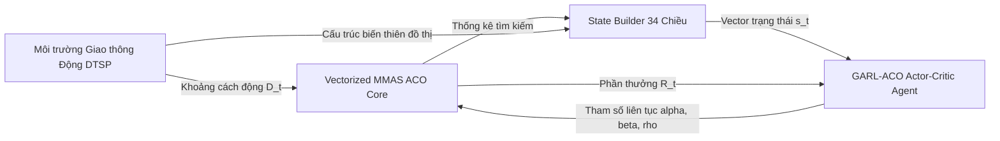

# 🐜 GARL-ACO: A Graph-Aware Reinforcement Learning Framework for Adaptive Parameter Control in Ant Colony Optimization

[](https://www.python.org/)
[](https://pytorch.org/)
[](https://streamlit.io/)
[](http://comopt.ifi.uni-heidelberg.de/software/TSPLIB95/)
[](LICENSE)

---

## 📌 1. Giới thiệu tổng quan (Overview)

Bài toán Người bán hàng động (**Dynamic Traveling Salesman Problem – DTSP**) là một bài toán tối ưu tổ hợp kinh điển mô phỏng các mạng lưới giao thông thực tế, nơi chi phí/thời gian di chuyển trên các cạnh liên tục biến đổi do tắc nghẽn giao thông hoặc sự cố hạ tầng. 

Mặc dù **Thuật toán Đàn kiến (Ant Colony Optimization – ACO)** là một trong những siêu phỏng sinh học hiệu quả nhất cho các bài toán định tuyến, hiệu năng của ACO phụ thuộc sống còn vào 3 siêu tham số điều khiển:
* $\alpha$ (*Hệ số trọng số Pheromone*): Cân bằng giữa khai thác (exploitation) và khám phá (exploration).
* $\beta$ (*Hệ số tri thức Heuristic khoảng cách*): Quyết định mức độ ưu tiên chọn đường ngắn cục bộ.
* $\rho$ (*Tốc độ bay hơi Pheromone*): Cơ chế "quên" các cung đường cũ để thoát khỏi cực trị địa phương.

Trong các phương pháp truyền thống, các tham số này thường được cấu hình tĩnh hoặc điều chỉnh rời rạc thủ công, dẫn đến việc đàn kiến dễ rơi vào **bế tắc tìm kiếm (search stagnation)** hoặc **sụp đổ hoàn toàn** khi môi trường giao thông biến động mạnh.

**GARL-ACO** đề xuất một khung học tăng cường sâu nhận thức cấu trúc hình học của đồ thị (**Graph-Aware Deep Reinforcement Learning**), sử dụng tác tử **DDPG (Deep Deterministic Policy Gradient)** trong không gian hành động liên tục để tự động điều khiển thích ứng bộ ba tham số $(\alpha, \beta, \rho)$ theo thời gian thực.

---

## 🧠 2. Kiến trúc mô hình GARL-ACO (Model Architecture)

Hệ thống hoạt động theo một chu trình điều khiển vòng lặp kín (Closed-loop feedback control):



### 2.1. Biểu diễn trạng thái 34 chiều nhận thức đồ thị (34-dim State Vector)
Vector trạng thái $s_t \in \mathbb{R}^{34}$ được trích xuất kết hợp giữa hình học không gian đồ thị và động thái bầy kiến:
1. **18 Đặc trưng cấu trúc đồ thị (Graph-Aware Structural Features)**:
   * **Độ kết nối đại số Fiedler ($\lambda_2$)**: Trị riêng nhỏ thứ nhì của ma trận Laplacian chuẩn hóa đồ thị $L = I - D^{-1/2} A D^{-1/2}$, phản ánh độ liên kết toàn cục của mạng lưới.
   * **Phân bố bậc k-NN ($k \in \{3, 5, 10\}$)**: Thống kê mean, std, skewness của ma trận khoảng cách $k$ láng giềng gần nhất.
   * **Mật độ cụm tắc nghẽn (Congestion Clustering)**: Tỷ lệ cạnh bị tác động, phương sai trọng số và biên độ nhiễu tức thời.
   * **Bán kính & Độ lệch tâm không gian**: Đo lường sự phân tán của các cụm thành phố.
2. **16 Đặc trưng động học tìm kiếm ACO (Search & Dynamic Features)**:
   * **Tiến độ tour chuẩn hóa**: `norm_best_len`, `norm_iter_best_len`, `norm_iter_mean_len`.
   * **Hệ số hội tụ đàn**: `conv_factor = std(tours) / mean(tours)`.
   * **Tốc độ cải thiện lộ trình**: `imp_5`, `imp_20` qua 5 và 20 vòng lặp gần nhất.
   * **Thước đo đình trệ**: `norm_stagnation` (số vòng không cải thiện).
   * **Entropy phân phối Pheromone**: `tau_mean`, `tau_min`, `tau_max`, `tau_std`, `tau_entropy`.
   * **Bộ nhớ tham số chuẩn hóa**: `norm_alpha`, `norm_beta`, `norm_rho` và `progress_ratio`.

---

### 2.2. Tác tử DDPG liên tục với Layer Normalization & Noise Decay
* **Mạng Actor ($\pi_\theta$)**: Kiến trúc $34 \to 128 \to 128 \to 3$ tích hợp các lớp **Layer Normalization (`LayerNorm`)** sau mỗi tầng ẩn và khởi tạo trọng số ngẫu nhiên cực nhỏ ($[-0.003, 0.003]$) tại tầng xuất để ngăn chặn triệt để hiện tượng **bão hòa hàm $tanh$ (Tanh Saturation)**.
* **Không gian hành động liên tục**:
  $$\alpha \in [0.5, 3.0], \quad \beta \in [2.0, 6.0], \quad \rho \in [0.05, 0.50]$$
* **Mạng Critic ($Q_\phi$)**: Kiến trúc $37 \to 128 \to 128 \to 1$ ước lượng hàm giá trị hành động tối ưu $Q(s, a)$.
* **Lịch trình suy giảm nhiễu OU (Ornstein-Uhlenbeck Noise Decay)**:
  $$\sigma(e) = \sigma_{\mathrm{start}} + (\sigma_{\mathrm{end}} - \sigma_{\mathrm{start}}) \cdot \frac{e - 1}{E_{\mathrm{max}} - 1}, \quad (\sigma: 0.35 \to 0.05)$$
  Giúp tác tử khám phá mạnh mẽ ở giai đoạn đầu để thoát khỏi bẫy biên dưới của $\beta$, sau đó hội tụ mượt mà và ổn định chính sách khai thác ở cuối quá trình học.

---

### 2.3. Chiến lược Huấn luyện Chương trình hóa (Curriculum Learning)
Quá trình huấn luyện trải qua 4 giai đoạn với độ phức tạp đồ thị tăng dần:
* **Giai đoạn 1 (Ep 1–100)**: Huấn luyện cơ sở trên `kroA200` ($N=200$).
* **Giai đoạn 2 (Ep 101–200)**: Mở rộng sang `[kroA200, pr439]` ($N \le 439$).
* **Giai đoạn 3 (Ep 201–300)**: Bổ sung đồ thị dạng lưới `[kroA200, pr439, rat575]` ($N \le 575$).
* **Giai đoạn 4 (Ep 301–400)**: Thử thách trên đồ thị quy mô lớn `[kroA200, pr439, rat575, u1060]` ($N \le 1060$).
* **Thử nghiệm Zero-Shot**: Đánh giá khả năng tổng quát hóa trực tiếp trên `pcb1173` ($N=1173$, hoàn toàn chưa từng huấn luyện).

---

## 📊 3. Kết quả Thực nghiệm (Experimental Results)

Mô hình được đánh giá trên 5 bộ dữ liệu chuẩn TSPLIB dưới môi trường giao thông động hình sin (`perturb_ratio = 0.12`, `perturb_amplitude = 0.5`, `perturb_period = 20` vòng lặp) với 3 seed độc lập:

| Benchmark Instance | Số nút ($N$) | Lời giải Tối ưu ($L^*$) | Phương pháp | Chiều dài Tour TB ($\mu \pm \sigma$) | Optimality Gap (%) | Std Gap (%) | Thời gian phục hồi (Recovery) |
|:---|:---:|:---:|:---|:---:|:---:|:---:|:---:|
| **kroA200** | 200 | 29,368 | Fixed ACO <br> ACO + Q-Learning <br> **GARL-ACO (Đề xuất)** | 64,336.9 <br> 34,050.6 <br> **33,065.4** | 119.07% <br> 15.94% <br> **12.59%** | 7.17% <br> 2.65% <br> **0.35%** | 1.0 iters <br> 7.3 iters <br> **0.0 iters** |
| **pr439** | 439 | 107,217 | Fixed ACO <br> ACO + Q-Learning <br> **GARL-ACO (Đề xuất)** | 571,182.4 <br> 125,230.4 <br> **122,082.0** | 432.73% <br> 16.80% <br> **13.86%** | 8.87% <br> 1.16% <br> **1.76%** | 1.0 iters (1/3 kẹt) <br> 4.3 iters <br> **0.7 iters** |
| **rat575** | 575 | 6,773 | Fixed ACO <br> ACO + Q-Learning <br> **GARL-ACO (Đề xuất)** | 8,118.8 <br> 8,220.8 <br> **7,937.9** | 19.87% <br> 21.38% <br> **17.20%** | 0.44% <br> 1.94% <br> **1.90%** | 0.0 iters <br> 7.3 iters <br> **0.0 iters** |
| **u1060** | 1,060 | 224,094 | Fixed ACO <br> ACO + Q-Learning <br> **GARL-ACO (Đề xuất)** | 1,875,850.0 <br> 322,301.3 <br> **285,826.8** | 737.08% <br> 43.82% <br> **27.55%** | 17.32% <br> 3.52% <br> **3.16%** | 1.0 iters (2/3 kẹt) <br> 1.0 iters <br> **0.0 iters** |
| **pcb1173\*** <br> *(Zero-Shot)* | 1,173 | 56,892 | Fixed ACO <br> ACO + Q-Learning <br> **GARL-ACO (Đề xuất)** | 96,157.7 <br> 78,289.2 <br> **71,139.2** | 69.02% <br> 37.61% <br> **25.04%** | 3.06% <br> 0.27% <br> **0.27%** | 1.0 iters <br> 1.0 iters <br> **0.0 iters** |

*\* Ghi chú: `pcb1173` là tập kiểm thử Zero-Shot, hoàn toàn không tham gia huấn luyện.*

---

## 📈 4. Trực quan hóa Đường cong Hội tụ (Convergence Visualizations)

### 4.1. So sánh tổng hợp chỉ số Gap % trên 5 bộ dữ liệu


### 4.2. Đồ thị hội tụ thời gian thực chi tiết từng Instance

| Instance `kroA200` ($N=200$) | Instance `pr439` ($N=439$) |
|:---:|:---:|
|  |  |
| **Instance `rat575` ($N=575$)** | **Instance `u1060` ($N=1060$)** |
|  |  |

#### 🎯 Đánh giá Zero-Shot trên `pcb1173` ($N=1173$):


---

## 🚀 5. Hướng dẫn Cài đặt & Chạy Thực nghiệm (Getting Started)

### 5.1. Yêu cầu môi trường
* Python $\ge$ 3.10
* Cài đặt các thư viện phụ thuộc:
```bash
pip install torch numpy scipy matplotlib streamlit networkx
```

### 5.2. Chạy ứng dụng Demo tương tác (Interactive Streamlit GUI)
```bash
python -m streamlit run "GARL-ACO/GARL ACO/demo_app.py"
```
*(Giao diện hỗ trợ điều chỉnh số lượng kiến, số vòng lặp, bật/tắt tắc đường và trực quan hóa bản đồ 2D lộ trình thời gian thực).*

### 5.3. Huấn luyện lại mô hình (Curriculum Training)
```bash
python "GARL-ACO/GARL ACO/train.py" --episodes 400 --n_iter 150
```

### 5.4. Đánh giá kiểm thử Benchmarks (Evaluation Suite)
```bash
python "GARL-ACO/GARL ACO/evaluate.py" --n_iter 150 --n_runs 3
```

### 5.5. Tự động xuất biểu đồ so sánh độ tụ (Convergence Curves)
```bash
python "GARL-ACO/GARL ACO/plot_convergence.py" --instance all
```

---

## 📁 6. Cấu trúc Thư mục Dự án (Project Structure)

```text
├── dataset/                               # Dữ liệu TSPLIB benchmark (.tsp)
├── GARL-ACO/
│   └── GARL ACO/
│       ├── aco/                           # Vectorized MMAS ACO engine
│       │   └── aco_core.py
│       ├── agent/                         # DDPG, Q-Learning & State Builder
│       │   ├── ddpg_agent.py              # Actor-Critic với LayerNorm & OU Noise
│       │   ├── ql_agent.py                # Discrete Q-Learning Baseline
│       │   └── state_builder.py           # Bộ trích xuất 34 đặc trưng hình học
│       ├── checkpoints/                   # Trọng số mô hình đã train (.pt, .pkl)
│       ├── data/                          # Dataset loader & TSP parser
│       ├── env/                           # Dynamic TSP traffic simulation
│       │   └── dynamic_tsp_env.py
│       ├── plots/                         # Biểu đồ hội tụ & biểu đồ cột xuất bản
│       ├── baselines.py                   # Engine thực thi các baseline
│       ├── config.py                      # Cấu hình siêu tham số toàn hệ thống
│       ├── demo_app.py                    # Giao diện web Streamlit Demo
│       ├── evaluate.py                    # Script đánh giá kiểm thử 5 benchmarks
│       ├── plot_convergence.py           # Script vẽ so sánh độ tụ 3 mô hình
│       ├── plot_results.py               # Script vẽ bar chart tổng hợp
│       └── train.py                       # Pipeline Curriculum Learning 4 giai đoạn
└── README.md                              # Tài liệu kỹ thuật dự án (Technical Documentation)
```

---

## 📚 7. Tài liệu Tham khảo (References)

```text
[1] M. Dorigo, M. Birattari, and T. Stützle, “Ant colony optimization,” IEEE Computational Intelligence Magazine, vol. 1, no. 4, pp. 28–39, 2006.
[2] T. Stützle and H. H. Hoos, “MAX–MIN ant system,” Future Generation Computer Systems, vol. 16, no. 8, pp. 889–914, 2000.
[3] M. Dorigo, V. Maniezzo, and A. Colorni, “Ant system: optimization by a colony of cooperating agents,” IEEE Transactions on Systems, Man, and Cybernetics, Part B, vol. 26, no. 1, pp. 29–41, 1996.
[4] M. Dorigo and L. M. Gambardella, “Ant colony system: a cooperative learning approach to the traveling salesman problem,” IEEE Transactions on Evolutionary Computation, vol. 1, no. 1, pp. 53–66, 1997.
[5] A. E. Eiben, R. Hinterding, and Z. Michalewicz, “Parameter control in evolutionary algorithms,” IEEE Transactions on Evolutionary Computation, vol. 3, no. 2, pp. 124–141, 1999.
[6] T. P. Lillicrap et al., “Continuous control with deep reinforcement learning,” in ICLR, 2016.
[7] R. S. Sutton and A. G. Barto, Reinforcement Learning: An Introduction. MIT Press, 2018.
[8] E. Khalil, H. Dai, Y. Zhang, B. Dilkina, and L. Song, “Learning combinatorial optimization algorithms over graphs,” in NIPS, 2017, pp. 6348–6358.
[9] Y. Bengio, A. Lodi, and A. Prouvost, “Machine learning for combinatorial optimization: a methodological tour d’horizon,” European Journal of Operational Research, vol. 290, no. 2, pp. 405–421, 2021.
[10] G. Reinelt, “TSPLIB—A Traveling Salesman Problem Library,” INFORMS Journal on Computing, vol. 3, no. 4, pp. 376–384, 1991.
[11] Z. Zhang, H. Liu, M. Zhou, and J. Wang, “Solving dynamic traveling salesman problems with deep reinforcement learning,” IEEE Transactions on Neural Networks and Learning Systems, vol. 34, no. 4, pp. 2119–2132, 2023.
[12] M. Fiedler, “Algebraic connectivity of graphs,” Czechoslovak Mathematical Journal, vol. 23, no. 2, pp. 298–305, 1973.
[13] Y. Bengio, J. Louradour, R. Collobert, and J. Weston, “Curriculum learning,” in Proc. 26th International Conference on Machine Learning (ICML), 2009, pp. 41–48.
[14] W. Kool, H. van Hoof, and M. Welling, “Attention, learn to solve routing problems!,” in ICLR, 2019.
[15] J. L. Ba, J. R. Kiros, and G. E. Hinton, “Layer normalization,” arXiv preprint arXiv:1607.06450, 2016.
[16] V. Mnih et al., “Human-level control through deep reinforcement learning,” Nature, vol. 518, no. 7540, pp. 529–533, 2015.
[17] N. Mazyavkina, S. Sviridov, S. Ivanov, and E. Burnaev, “Reinforcement learning for combinatorial optimization: a survey,” Computers & Operations Research, vol. 134, p. 105400, 2021.
```
